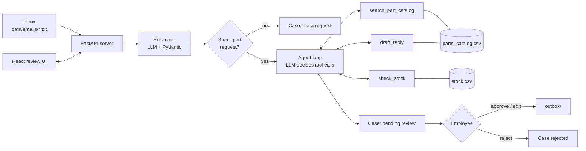

# Spare-Parts Request Agent

An LLM agent that reads customer e-mails asking for spare parts, finds the right parts in a catalog, checks stock and delivery times, and prepares a reply draft. **A human employee always reviews, edits and approves the draft before anything is sent.**

> Portfolio project. All companies, machines, parts, prices and e-mails are **synthetic demo data**.


---

## The problem

Industrial manufacturers receive many spare-part requests by e-mail. They are written in different languages and styles, often with incomplete or wrong part numbers, several parts in one e-mail, or unclear details. Today an employee has to read each e-mail, search the catalog, check stock and write a reply by hand.

This project shows how an **AI agent with tool calling** can do the repetitive part of this work — while the employee keeps the final decision.

## What it does

1. **Inbox** – incoming e-mails (text files for now) appear in an inbox.
2. **Extraction** – the LLM turns the e-mail into structured data (customer, contact, machine model, urgency, language, list of requested parts). The output is validated with Pydantic.
3. **Agent loop** – the LLM decides by itself which tools to call and in which order:
   - `search_part_catalog` – fuzzy search by part number or part name (German or English), filtered by machine model
   - `check_stock` – stock, quantity to order, delivery time
   - `draft_reply` – builds the reply (German or English) from a fixed template
4. **Human in the loop** – the employee sees the original e-mail, the extracted data, every tool call with its result, the agent's summary and the draft. They can edit, approve or reject. Only approved replies go to the `outbox/`.

## Screenshots

**Inbox and case list** – processed e-mails leave the inbox and become cases with a review status.


**Tool call trace** – the employee can see every tool the agent called, with its arguments. Each entry can be expanded to show the tool result. Below it, the reply draft can be edited before approval.


## Architecture



### The agent loop

```
messages = [system prompt, e-mail + extracted data]
repeat (max 10 steps):
    response = LLM(messages, tools)
    if no tool call  -> final summary, stop
    for each tool call:
        result = run the Python function   # the LLM never executes code itself
        append result to messages
```

The loop is written by hand (about 50 lines, no agent framework) so that every step is transparent and easy to explain.

### Fixed pipeline (RAG) vs. agent with tool calling

| | Fixed RAG pipeline | Agent with tool calling |
|---|---|---|
| Who decides the steps? | The code, always the same order | The LLM, depending on each e-mail |
| Role of the LLM | Write an answer from retrieved documents | Plan and coordinate tool calls |
| Unclear input | Same path every time | E.g. wrong part number → searches again by name |
| Risk | Low, predictable | Higher → needs limits, validation and human review |

This project is deliberately **hybrid**: extraction is a fixed step, only the part-matching and drafting is agentic.

## Design decisions

- **No numbers from the LLM in the offer.** The LLM only chooses part numbers, quantities and questions. Names, prices, stock and delivery times are filled in by `draft_reply` from the data.
- **Deterministic rules live in code, not in the prompt.** Example: the "urgent but not in stock" warning is computed in Python from the tool results. An earlier prompt-based version was not followed reliably.
- **Tools return errors as data.** An unknown part number does not crash the loop; the LLM sees the error and can correct itself.
- **Extraction copies, tools correct.** The extractor keeps a wrong part number exactly as the customer wrote it. Finding the right part is the job of the tools — this makes errors traceable.
- **Ambiguity → ask, don't guess.** If two parts fit equally well (e.g. check valve DN6 vs. DN10), the agent leaves the part out and asks the customer.
- **Validation everywhere.** Pydantic schemas for LLM output and API requests; case IDs and inbox file names are checked against strict patterns.
- **Every review decision is recorded** (edited or not, note, time) — useful as feedback to improve the agent.

## Tech stack

| Area | Tools |
|---|---|
| LLM | Groq API (OpenAI-compatible), model configurable in `.env` |
| Backend | Python 3.12, FastAPI, Pydantic, pandas |
| Frontend | React, Vite |
| Tests | pytest (tools and API, LLM mocked in API tests) |

## Project structure

```
spare-parts-agent/
├── data/
│   ├── parts_catalog.csv      # 32 synthetic parts for 5 machine models
│   ├── stock.csv              # stock and lead times
│   └── emails/                # incoming e-mails (the inbox)
├── src/
│   ├── config.py              # settings from .env
│   ├── llm_client.py          # shared LLM client
│   ├── schemas.py             # Pydantic models for extraction
│   ├── extractor.py           # e-mail -> structured data
│   ├── tools.py               # search_part_catalog, check_stock, draft_reply
│   ├── agent.py               # tool definitions, system prompt, agent loop
│   ├── case_store.py          # cases as JSON files, approve / reject
│   └── api.py                 # FastAPI endpoints
├── frontend/                  # React review UI
├── scripts/                   # command-line helpers
├── tests/                     # pytest
├── .env.example
└── requirements.txt
```

## How to run (Windows)

**Requirements:** Python 3.12, Node.js, a free [Groq API key](https://console.groq.com/keys).

```powershell
git clone https://github.com/amin-ghasemi-de/spare-parts-agent.git
cd spare-parts-agent

python -m venv .venv
.venv\Scripts\activate
pip install -r requirements.txt

copy .env.example .env
# open .env and add your Groq API key
```

**Start the backend** (terminal 1, project root):

```powershell
uvicorn src.api:app --reload
```

API docs: http://127.0.0.1:8000/docs

**Start the frontend** (terminal 2):

```powershell
cd frontend
npm install
npm run dev
```

UI: http://localhost:5173

**Run the agent from the command line:**

```powershell
python -m scripts.run_agent email_003.txt
```

**Run the tests:**

```powershell
python -m pytest
```

To reset the demo, delete the `storage/` folder — all e-mails return to the inbox.

## Evaluation

The agent is evaluated on **20 synthetic e-mails** with hand-written correct answers (`eval/ground_truth.json`):

- **7 dev e-mails** (`data/emails/`) – used while developing and tuning the prompt
- **13 held-out e-mails** (`eval/emails/`) – written after prompt development and never used for prompt tuning

Each run executes the full pipeline (extraction + agent loop) on every e-mail. Scoring is automatic (`src/evaluation.py`). The offer is read from the arguments of the last `draft_reply` tool call, not from the free text of the reply.

### Results

Run 1 = original code. Run 2 = after two bug fixes (see below). The prompt was not changed between the runs.

| Metric | Run 1 | Run 2 | Run 2: dev | Run 2: held-out |
|---|---|---|---|---|
| E-mails | 20 | 20 | 7 | 13 |
| Errors | 1 | 0 | 0 | 0 |
| Spare-part request detected correctly | 19/19 | 20/20 | 7/7 | 13/13 |
| Machine model extracted | 18/18 | 18/19 | 7/7 | 11/12 |
| Urgency, language, number of items extracted | 18/18 | 19/19 | 7/7 | 12/12 |
| Expected parts found | 18/21 | 21/22 | 9/10 | 12/12 |
| **Wrong parts offered** | **0** | **0** | **0** | **0** |
| Offer exactly right (all parts, correct quantities, nothing extra) | 16/18 | 18/19 | 6/7 | 12/12 |
| Asked the customer when needed, and only then | 15/16 | 16/17 | 6/6 | 10/11 |
| Urgency warning correct | 18/18 | 19/19 | 7/7 | 12/12 |
| Avg tokens per e-mail | 7,867 | 7,923 | 9,352 | 7,153 |
| Avg LLM calls per e-mail | 5.5 | 5.5 | 6.1 | 5.1 |

**Consistency:** 17 of 18 e-mails got exactly the same offer in both runs. The only difference is e-mail 018, which was fixed on purpose.

### Failure analysis

Every failure was traced through the tool-call log of the result file.

| E-mail | What happened | Root cause | Status |
|---|---|---|---|
| 018 | Run 1: no offer, unnecessary question | The search tool compared the machine model exactly: `hpc300` ≠ `HPC-300`, so all four searches returned nothing | **Fixed in run 2:** model names are normalized; unknown models return a warning instead of an empty list |
| 015 | Run 1: error. Run 2: correct part, but an odd question to the customer | The extractor put the machine model `H2D-700` into the **part-number** field. Run 1: the agent passed `machine_model: null`, which the tool schema did not allow → API error. Run 2: the agent found the right part, but asked the customer to confirm "part number H2D-700" | Schema **fixed in run 2**. Extraction issue **not fixed** |
| 006 | Valve left out, customer asked for the quantity (both runs) | Quantity was only implicit ("das Ventil"). The agent found the valve and checked stock, but then chose to ask | **Not fixed** |

Why 015 and 006 were not fixed: both would need a prompt or extraction change, and the same patterns appear in held-out e-mails. Changing the system after seeing these results would make the held-out numbers meaningless.

A possible fix for 015 is a deterministic rule in code: if an extracted part number is a known machine model, move it to `machine_model`. Part numbers and machine models look similar in this catalog (`H2D-700` vs. `H2D-SNS-331`), which is a real-world source of confusion for people and models alike.

### How to read these numbers

- **Small sample:** 19 scored e-mails per run. Each e-mail moves a percentage by about 5 points, so results are shown as counts.
- **The run-2 fixes were found on held-out e-mails.** The run-2 held-out numbers are therefore slightly optimistic. An unbiased estimate after the fixes would need a fresh test set.
- **All failures were omissions or unnecessary questions** – never a wrong part. In a spare-parts process, a missing line is much cheaper than a wrong delivery.
- **Time:** an average run took about 30 s, but this includes waiting for the free-tier rate limit (8,000 tokens per minute). A single simple e-mail takes about 3 s.

Reproduce:

```powershell
python -m scripts.run_eval --run 1
python -m scripts.eval_report
```

Full report with every e-mail: [`eval/results/report.md`](eval/results/report.md)

## Known limitations

- **Synthetic data** – small catalog (32 parts), hand-written e-mails.
- **Non-deterministic LLM** – the same e-mail can produce differently worded questions and summaries, even at temperature 0.
- **Summary for the employee** is written by the LLM and sometimes misreports stock numbers. The tool call trace in the UI always shows the correct values.
- **Quantity is required** by `draft_reply`; if the customer gives none, the agent has to assume one.
-**Implicit quantities** ("das Ventil", "a pump") are handled differently: for e-mail 006 the agent always asks, for e-mail 019 it offers quantity 1.
- **Machine models can be mistaken for part numbers** during extraction, because both use a similar format.
- **The summary for the employee often repeats the full draft**, although the prompt says not to.
- **Cost grows with every agent step**, because each step sends the whole conversation again (simple e-mail: about 6,700 tokens; three parts: about 13,800 tokens).
- **No delivery address** is extracted.
- **Reply languages:** German and English only.
- **Storage:** cases are JSON files, not a database. No users or authentication yet.
- **No real e-mail** is read or sent; the inbox and outbox are folders.

## Roadmap

- [x] Evaluation set (20 e-mails) and first run
- git add .[x] Run 2 after bug fixes
- [ ] Fresh held-out set for an unbiased estimate after the fixes
- [ ] n8n workflow: real mailbox trigger → this API → approval → send
- [ ] Online demo on Azure App Service
- [ ] Database instead of JSON files

## Author

Amin Ghasemi – M.Sc. System Engineering student (Ostfalia University of Applied Sciences)
GitHub: [amin-ghasemi-de](https://github.com/amin-ghasemi-de)
