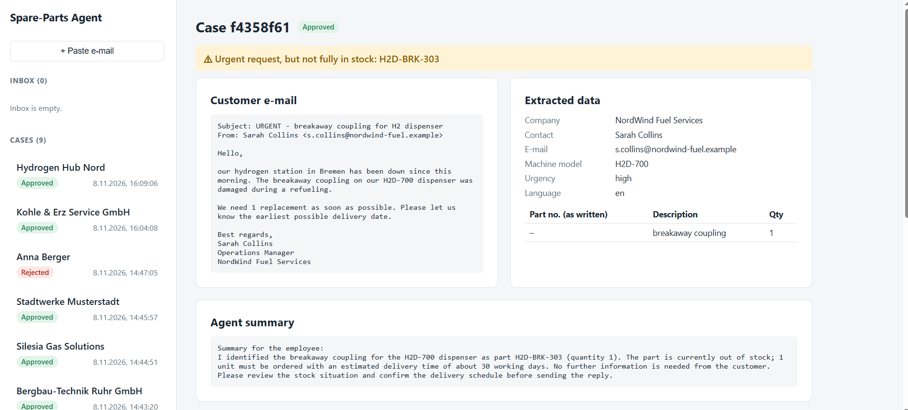
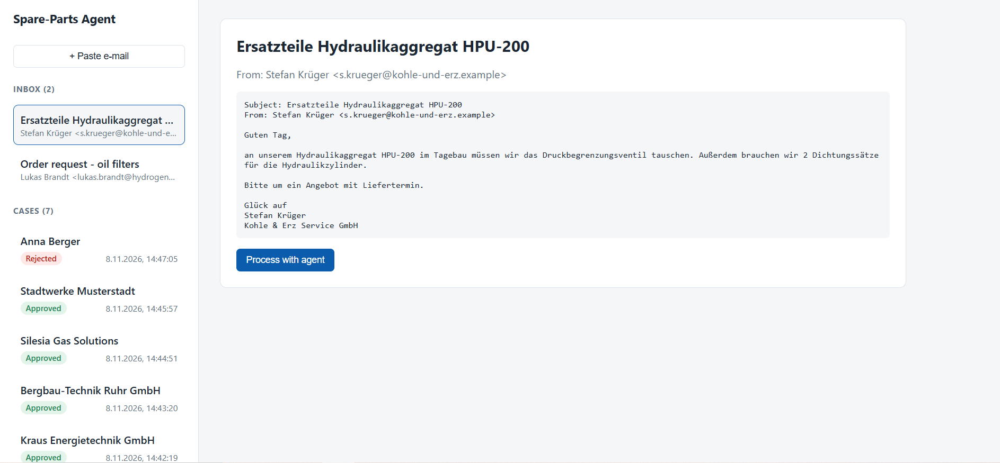
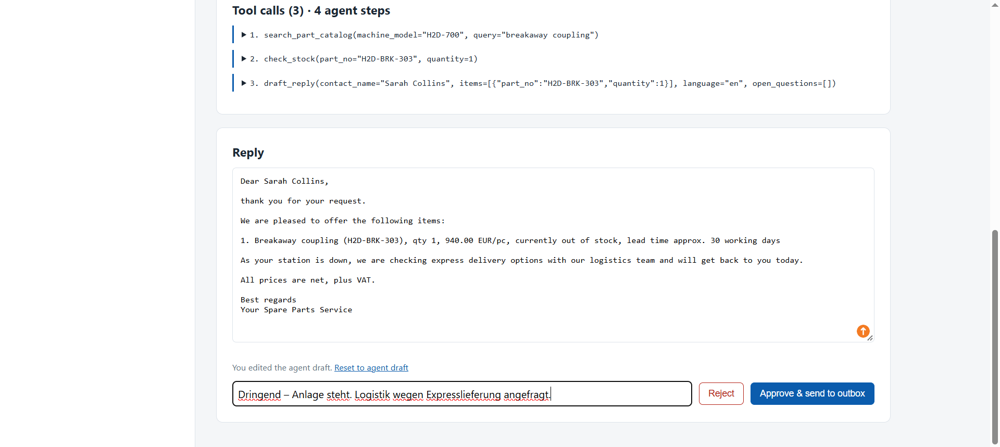
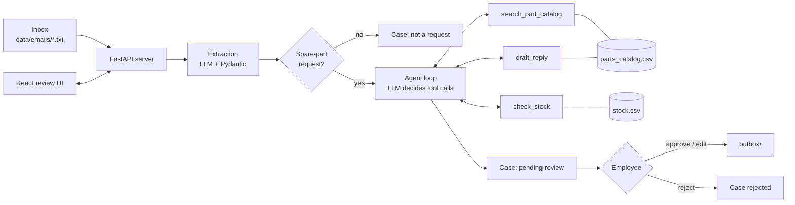

# Spare-Parts Request Agent

An LLM agent that reads customer e-mails asking for spare parts, finds the right parts in a catalog, checks stock and delivery times, and prepares a reply draft. **A human employee always reviews, edits and approves the draft before anything is sent.**

> Portfolio project. All companies, machines, parts, prices and e-mails are **synthetic demo data**.


---

## The problem

Industrial manufacturers receive many spare-part requests by e-mail. They are written in different languages and styles, often with incomplete or wrong part numbers, several parts in one e-mail, or unclear details. Today an employee has to read each e-mail, search the catalog, check stock and write a reply by hand.

This project shows how an **AI agent with tool calling** can do the repetitive part of this work — while the employee keeps the final decision.

## What it does

1. **Inbox** – incoming e-mails (text files for now) appear in an inbox.
2. **Extraction** – the LLM turns the e-mail into structured data (customer, contact, machine model, urgency, language, list of requested parts). The output is validated with Pydantic.
3. **Agent loop** – the LLM decides by itself which tools to call and in which order:
   - `search_part_catalog` – fuzzy search by part number or part name (German or English), filtered by machine model
   - `check_stock` – stock, quantity to order, delivery time
   - `draft_reply` – builds the reply (German or English) from a fixed template
4. **Human in the loop** – the employee sees the original e-mail, the extracted data, every tool call with its result, the agent's summary and the draft. They can edit, approve or reject. Only approved replies go to the `outbox/`.

## Screenshots

**Inbox and case list** – processed e-mails leave the inbox and become cases with a review status.



**Tool call trace** – the employee can see every tool the agent called and what it returned. Here the agent searched by part number, got no exact match, and searched again by part name.


## Architecture



### The agent loop

```
messages = [system prompt, e-mail + extracted data]
repeat (max 10 steps):
    response = LLM(messages, tools)
    if no tool call  -> final summary, stop
    for each tool call:
        result = run the Python function   # the LLM never executes code itself
        append result to messages
```

The loop is written by hand (about 50 lines, no agent framework) so that every step is transparent and easy to explain.

### Fixed pipeline (RAG) vs. agent with tool calling

| | Fixed RAG pipeline | Agent with tool calling |
|---|---|---|
| Who decides the steps? | The code, always the same order | The LLM, depending on each e-mail |
| Role of the LLM | Write an answer from retrieved documents | Plan and coordinate tool calls |
| Unclear input | Same path every time | E.g. wrong part number → searches again by name |
| Risk | Low, predictable | Higher → needs limits, validation and human review |

This project is deliberately **hybrid**: extraction is a fixed step, only the part-matching and drafting is agentic.

## Design decisions

- **No numbers from the LLM in the offer.** The LLM only chooses part numbers, quantities and questions. Names, prices, stock and delivery times are filled in by `draft_reply` from the data.
- **Deterministic rules live in code, not in the prompt.** Example: the "urgent but not in stock" warning is computed in Python from the tool results. An earlier prompt-based version was not followed reliably.
- **Tools return errors as data.** An unknown part number does not crash the loop; the LLM sees the error and can correct itself.
- **Extraction copies, tools correct.** The extractor keeps a wrong part number exactly as the customer wrote it. Finding the right part is the job of the tools — this makes errors traceable.
- **Ambiguity → ask, don't guess.** If two parts fit equally well (e.g. check valve DN6 vs. DN10), the agent leaves the part out and asks the customer.
- **Validation everywhere.** Pydantic schemas for LLM output and API requests; case IDs and inbox file names are checked against strict patterns.
- **Every review decision is recorded** (edited or not, note, time) — useful as feedback to improve the agent.

## Tech stack

| Area | Tools |
|---|---|
| LLM | Groq API (OpenAI-compatible), model configurable in `.env` |
| Backend | Python 3.12, FastAPI, Pydantic, pandas |
| Frontend | React, Vite |
| Tests | pytest (tools and API, LLM mocked in API tests) |

## Project structure

```
spare-parts-agent/
├── data/
│   ├── parts_catalog.csv      # 32 synthetic parts for 5 machine models
│   ├── stock.csv              # stock and lead times
│   └── emails/                # incoming e-mails (the inbox)
├── src/
│   ├── config.py              # settings from .env
│   ├── llm_client.py          # shared LLM client
│   ├── schemas.py             # Pydantic models for extraction
│   ├── extractor.py           # e-mail -> structured data
│   ├── tools.py               # search_part_catalog, check_stock, draft_reply
│   ├── agent.py               # tool definitions, system prompt, agent loop
│   ├── case_store.py          # cases as JSON files, approve / reject
│   └── api.py                 # FastAPI endpoints
├── frontend/                  # React review UI
├── scripts/                   # command-line helpers
├── tests/                     # pytest
├── .env.example
└── requirements.txt
```

## How to run (Windows)

**Requirements:** Python 3.12, Node.js, a free [Groq API key](https://console.groq.com/keys).

```powershell
git clone https://github.com/amin-ghasemi-de/spare-parts-agent.git
cd spare-parts-agent

python -m venv .venv
.venv\Scripts\activate
pip install -r requirements.txt

copy .env.example .env
# open .env and add your Groq API key
```

**Start the backend** (terminal 1, project root):

```powershell
uvicorn src.api:app --reload
```

API docs: http://127.0.0.1:8000/docs

**Start the frontend** (terminal 2):

```powershell
cd frontend
npm install
npm run dev
```

UI: http://localhost:5173

**Run the agent from the command line:**

```powershell
python -m scripts.run_agent email_003.txt
```

**Run the tests:**

```powershell
python -m pytest
```

To reset the demo, delete the `storage/` folder — all e-mails return to the inbox.

## Evaluation

🚧 **In progress.** A test set of about 25 e-mails with known correct answers is being built. Each e-mail will be run several times to measure:

- extraction accuracy per field
- correct part matching
- correct behaviour in ambiguous cases (ask instead of guess)

Results will be added here. Until then, the agent has only been checked manually on the sample e-mails.

## Known limitations

- **Synthetic data** – small catalog (32 parts), hand-written e-mails.
- **Non-deterministic LLM** – the same e-mail can produce differently worded questions and summaries, even at temperature 0.
- **Summary for the employee** is written by the LLM and sometimes misreports stock numbers. The tool call trace in the UI always shows the correct values.
- **Quantity is required** by `draft_reply`; if the customer gives none, the agent has to assume one.
- **No delivery address** is extracted.
- **Reply languages:** German and English only.
- **Storage:** cases are JSON files, not a database. No users or authentication yet.
- **No real e-mail** is read or sent; the inbox and outbox are folders.

## Roadmap

- [ ] Evaluation set and metrics
- [ ] n8n workflow: real mailbox trigger → this API → approval → send
- [ ] Online demo on Azure App Service
- [ ] Database instead of JSON files

## Author

Amin Ghasemi – M.Sc. System Engineering student (Ostfalia University of Applied Sciences)
GitHub: [amin-ghasemi-de](https://github.com/amin-ghasemi-de)
